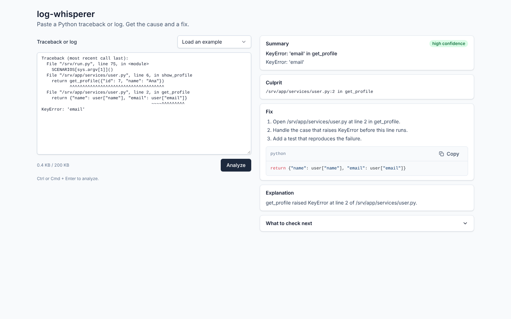
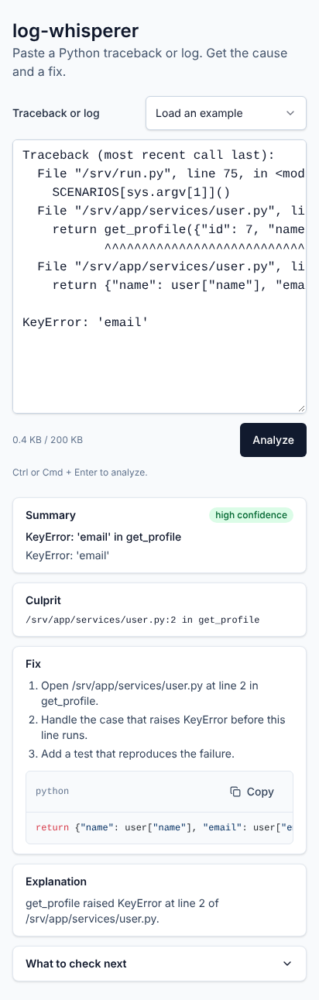

# log-whisperer

Paste a Python traceback or log. log-whisperer finds the likely cause, the culprit line and a fix.

## Screenshots

The images show the F01 example with the fake provider. `make screenshots` refreshes them.

| Desktop, 1440 × 900 | Phone, 412px wide |
|---|---|
|  |  |

## Quick start

Needs Docker with Compose v2.

```bash
cp .env.example .env
make up
```

| Service | URL |
|---|---|
| Web app | http://localhost:5173 |
| API | http://localhost:8000 (health: `/healthz`) |

Stop the stack with `make down`.

## Configuration

Compose reads these values from `.env`.

| Variable | Default | Meaning |
|---|---|---|
| `LLM_PROVIDER` | `fake` | `fake` gives a deterministic diagnosis. `anthropic` calls the model API. |
| `ANTHROPIC_API_KEY` | empty | Required when `LLM_PROVIDER=anthropic`. The backend does not start without it. |
| `RATE_LIMIT_PER_MINUTE` | `10` | Requests per minute per client IP. Must be a positive integer. |

## API

`POST /api/analyze` takes `{"input": "<log text>"}` and returns the diagnosis.

| Status | Body | When |
|---|---|---|
| 200 | `AnalysisResponse` | The analysis succeeded. |
| 400 | `{"error": "Input is empty"}` or `{"error": "Invalid request"}` | The input is blank, or the body is not valid. |
| 413 | `{"error": "Input too large"}` | The input is over 204,800 UTF-8 bytes. |
| 429 | `{"error": "Rate limit exceeded"}` | The client sent more than `RATE_LIMIT_PER_MINUTE` requests in 60 seconds. |
| 502 | `{"error": "Analysis failed"}` | The model failed or gave invalid output twice. |
| 500 | `{"error": "Internal error"}` | Any other failure. |

The backend masks secrets before the model sees the input. Logs hold only the request id, status, latency, kind and redaction count.

## Architecture

The backend uses ports and adapters. Imports point inward only, and `lint-imports` enforces this.

```
bootstrap ──► adapters ──► application ──► domain
(settings,    (FastAPI,     (AnalyzeLog     (Redactor, TracebackParser,
 wiring)       LLM)          use case)       GroundingPolicy, ports)
```

| Path | Contents |
|---|---|
| `backend/` | Python 3.12, FastAPI, uv |
| `frontend/` | Vite, React, TypeScript, Tailwind, TanStack Query |
| `SPEC.md` | Product and implementation spec |

## Commands

| Command | Result |
|---|---|
| `make install` | Installs backend and frontend dependencies. |
| `make up` / `make down` | Starts or stops the Compose stack. |
| `make lint` | Runs ruff, mypy, lint-imports, eslint and tsc. |
| `make test` | Runs pytest and vitest with coverage. |
| `make check-api` | Fails when the OpenAPI file or frontend API types are out of date. |
| `make fixtures` | Runs `backend/fixtures_src` under Python 3.10 to 3.13 and rewrites the fixtures. Needs uv 0.13.7 or later. |
| `uv run python scripts/perf_check.py` | Prints redactor and parser timings on adversarial input. Run it from `backend/`. It does not run in CI. |
| `make e2e` | Starts Compose with the fake provider and runs Playwright. |
| `make screenshots` | Starts Compose with the fake provider and rewrites `docs/screenshots/`. |
| `make eval` | Runs every fixture twice through the real model and prints a check table. Needs `ANTHROPIC_API_KEY`. It does not run in CI. |

## Conventions

- Frontend API types come from the backend OpenAPI file. Run `pnpm gen:api`; never edit `schema.ts`.
- Run `make lint && make test` before each pull request.
- Traceback fixtures come from real runs. Never edit a generated fixture; run `make fixtures`.
- No committed file holds a key-shaped string. `F11_secrets.txt` uses `{{secret:N}}`, and `expected.json` holds each secret in parts.
- Set `PW_CHROMIUM_PATH` to use a local Chromium for Playwright.
- The example picker bundles copies of F01, F04 and F10. A unit test fails when a copy differs from the backend fixture.
- `make e2e` saves screenshots at 1440px, 375px and on an emulated Pixel 7, and a video of the F01 flow. CI uploads them in `playwright-report`.
- On a phone, the input uses 16px text, so the browser does not zoom on focus. Buttons and the example picker are at least 44px high.

## Limits

| Limit | Value |
|---|---|
| Scope | Local Compose and CI only. No auth, database or cloud deploy. |
| Input size | 204,800 UTF-8 bytes. A larger input gets 413. |
| Long input | Above 60,000 characters, the analysis keeps every traceback and the last 200 lines. |
| Rate limit | Sliding 60-second window per client IP, held in memory. A restart clears it. |
| Several tracebacks | The diagnosis covers the last exception chain in the input. |
| Model timeout | 30 seconds, no SDK retries. One retry follows invalid model output. Then the API returns 502. |
